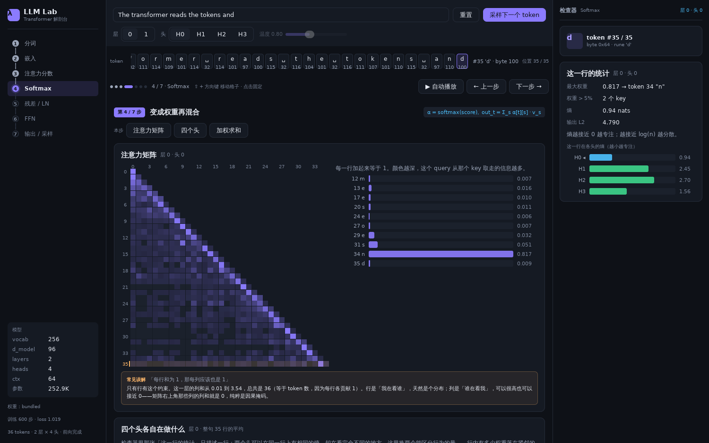

# LLM Lab · Transformer 解剖台

用 **MyGo** 的原生 UI（纯 Go、GPU 绘制、没有 WebView、没有 HTML/JS）写的一个 Transformer 架构学习工具：输入一句话，然后逐层剥开它——分词、嵌入、Q/K/V、注意力矩阵、残差与 LayerNorm、FFN、logits 与采样，每一步都能看到真实的数字。



## 为什么用 MyGo

- **一个 Go 二进制就够**：模型、前向计算、界面全在一个进程里，11 MB，没有 Python、没有 Node、没有浏览器内核。
- **界面就是数据**：`view` 是状态的函数，改一个滑块整帧重画，热力图/向量条带用 `ui.Box(...).Draw` 直接画在 GPU 上。
- **秒开**：和 Electron 系的教学工具比，启动时间与内存占用低一个数量级。

## 快速开始

需要 Go 1.27+（go.mod 要求 1.27.3，低版本会自动拉工具链），Linux 上还需要 GTK 3（`sudo apt install libgtk-3-0`）。

```bash
# 直接运行（默认 1500×940）
go run .

# 小屏：可以指定窗口尺寸，最小 1180×720
go run . -w 1180 -h 720

# 开发模式（改代码自动重启）
go tool mygo dev
```

## 多端构建

构建统一走 **just**（[安装](https://github.com/casey/just#installation)：`brew install just` / `winget install Casey.Just` / `scoop install just` / `cargo install just`）：

```bash
just            # 一次性构建 Windows + Linux + macOS
just build      # 同上；也可只构建指定平台
just linux      # linux/amd64 + linux/arm64
just windows    # windows/amd64
just mac        # darwin/universal（Intel + Apple Silicon）
just artifacts  # 列出已有产物与体积
just clean      # 清空 build/
```

默认产物（输出到 `build/<平台>/`）：

| 目标 | 产物 |
| --- | --- |
| `linux/amd64`、`linux/arm64` | 可执行文件、`llm-lab_<ver>_<arch>.deb`、带 `install.sh` 的 `.tar.gz`、`PKGBUILD` |
| `windows/amd64` | `LLM Lab.exe`；在 Windows 上构建时自动补 `LLM Lab-setup-<ver>-amd64.exe`（NSIS） |
| `darwin/universal` | `LLM Lab.app`（同时含 arm64 与 amd64）；在 macOS 上构建时额外产出 `.dmg`，可配置签名/公证 |

MyGo 不依赖 cgo，所以**在任意系统上都能交叉编译三端**，不需要 macOS 机器也能出 `.app`。只有三件事必须在 macOS 本机完成：`.dmg` 打包、Developer ID 签名、公证。Windows 安装包需要 `makensis`，Linux/macOS 上没装就跳过，不影响 exe 本体。

单平台构建不会清掉其他平台的产物，`just linux` 之后 `build/windows-amd64/` 仍在。Windows 上运行 just 需要 Git Bash（justfile 用 bash 作为 shell）。

不想装 just 时，等价命令是：

```bash
go tool mygo build -platform linux/amd64,linux/arm64,windows/amd64,darwin/universal
```

## 开发

```bash
just fmt      # gofmt -w
just check    # gofmt 检查 + go vet + go test（CI 同款）
```

改模型或界面后的验证标准（对拍、无窗口截图）见 [CONTRIBUTING.md](CONTRIBUTING.md)，版本变更见 [CHANGELOG.md](CHANGELOG.md)。CI 在 Linux/macOS/Windows 三个平台跑测试并各打一次包；推 `v*` tag 会自动建 release 并上传三端安装包。

启动后：

| 操作 | 效果 |
| --- | --- |
| 顶部输入框 | 改提示词，实时重跑前向 |
| 常驻 token 条 | 七个阶段都在，点一格选中它；热力图悬停时标出 query / key |
| `Shift` + 方向键 | 第 3、4 步在注意力矩阵里移动格子（↑↓ 换 query，←→ 换 key）；其余步骤移动 token 选择 |
| 示例胶囊（英文 / 中文 / 长提示词 / 空） | 一键切换提示词，演示 CJK 与截断 |
| 层 / 头 分段控件 | 切换观察第几层、第几个注意力头（第 3–6 / 3–4 步可用，其余阶段置灰） |
| 温度滑块 | 实时重算 softmax 分布（只在第 7 步生效，其余阶段置灰） |
| 点击 token 胶囊 | 右侧检查器显示该 token 在当前阶段的数值 |
| 悬停热力图单元格 | 显示 (query, key, 分数, 权重)，并把这一格的 softmax 算式写出来 |
| 点击热力图单元格 | 固定这一格：指针移开也留在检查器里；再点一次或按 `Esc` 解除 |
| 采样并续写 | 按当前温度抽一个 token 追加到提示词；卡片会显示这次抽样用到的种子与区间，同一句提示词永远得到同一个结果 |
| `←` / `→` | 上一个 / 下一个阶段 |
| `Shift` + `←` / `→` | 选中上一个 / 下一个 token |
| `空格` | 自动播放 / 暂停 |
| `1`–`7` | 直接跳到第 N 个阶段 |
| `Esc` | 停止自动播放 |

## 七个阶段与代码的对应关系

每一行写成「界面读的是哪个字段 → 由哪个函数算出 → 写回哪个字段」，字段都在 `model.Trace` 里，界面只是渲染它们。左列可以直接对照界面上的数字。

| 界面阶段 | 公式 | 读 | 函数 | 写回 |
| --- | --- | --- | --- | --- |
| 1 分词 | `id = byte(prompt)` | 提示词字符串 | `tokenizer.go: Tokenize` → `Truncate` | `Trace.Tokens`（每个 UTF-8 字节一个） |
| 2 嵌入 | `x = E[id] + P[t]` | `Weights.TokEmbed`、`PosEmbed` | `Forward` 开头的 `copy` + `addInto` | `Trace.Embed` / `Trace.Pos` / `Trace.Input` |
| 3 Q/K/V 与分数 | `score = q·k / √d_head`，`s ≤ t` | `LayerTrace.Norm1` | `matMulRows`（三个投影）+ `dot`，掩码处写 `-Inf` | `HeadTrace.Q/K/V`、`HeadTrace.Scores` |
| 4 Softmax 与加权 | `α = softmax(score)`，`out = Σ α·v` | `HeadTrace.Scores` | `tensor.go: softmaxCausal`，再逐行加权 `V` | `HeadTrace.Attn`、`HeadTrace.Out` |
| 5 残差 / LN | `x ← x + Attn(LN₁(x))`；`x ← x + FFN(LN₂(x))` | `LayerTrace.In`、`AttnProj`、`FFNOut` | `tensor.go: layerNorm` + `addInto` | `Norm1`、`AfterAttn`、`Norm2`、`AfterFFN` |
| 6 FFN | `W₂ · GELU(W₁ · LN(x))` | `LayerTrace.Norm2` | `matMulRows` → `tensor.go: gelu` → `matMulRows` | `Hidden`（d_ff 宽）、`FFNOut` |
| 7 输出与采样 | `p = softmax(logits / T)` | `LayerTrace.AfterFFN` 的最后一行 | `layerNorm` → 与 `TokEmbed` 点积（权重绑定） | `FinalNorm`、`Logits`；`weights.go: Probabilities` 再按温度做 softmax |

三处容易看漏的细节：

- **头是分开算的**：`HeadProj[h]` 是 `Out_h · Wo[h*d_head:(h+1)*d_head]`，`AttnProj` 就是各头之和，所以第 4 步卡片里「本头贡献」和「全部头相加」是两个不同的量。
- **`-Inf` 是掩码，不是数值**：`Scores` 右上角是 `negInf`，`softmaxCausal` 直接在 `i+1` 处截断，从不真的对它做指数。
- **`Logits` 只有一行**：`FinalNorm` 是 `T × d_model`，但 `Trace.Logits` 只保存**最后一个位置**的那一行，宽度是词表大小（本模型 96 → 256），所以第 7 步看的是「最后一个 token 之后的那个字」。

每次 `Forward` 会把每个中间张量录进 `model.Trace`（`gpt.go`），界面只读这份缓存——所以拖动滑块、切换层/头都不需要重算整个网络。

切换阶段时中栏和检查器会淡入（160ms）。动效只改不透明度、不动位置，因为这个工具的用法就是在一个固定位置比较两个阶段的数据。系统开启「减少动效」时切换是瞬间完成的，没有过渡帧。

第 2 步的嵌入相加、第 3 步的分数点积、第 4 步的注意力权重、第 5 步的残差累加与 LayerNorm、第 6 步的 FFN 求和与第 7 步的采样都会把算式写出来（带当前数据的具体数字），读者可以照着手算并得到卡片上那个值。

第 3、4、5、6、7 步各带一条「常见误解」：先写出画面上最容易得出的错误读法，再用**当前提示词下这个模型真实算出来的数字**纠正它（行平移不变、列和不受约束、GELU 的负输出下界、概率高不等于正确）。这些数字每次都从 `Trace` 现算，换提示词、换权重都会跟着变。

## 模型

内置的是一个**字符/字节级微型 GPT**，参数量 25.3 万：

```
vocab 256 · d_model 96 · 2 层 · 4 头 · d_ff 384 · ctx 64
```

权重由 `tools/train.py` 用 PyTorch（CPU，约 45 秒）在 61 句关于 Transformer 的英文句子训练 600 步得到，导出为 `internal/model/weights.json` 并 `go:embed` 进二进制。

```bash
python3 tools/train.py                 # 复现权重
python3 tools/train.py --steps 2000    # 更收敛、分布更尖
go run . -weights /path/to/other.json  # 换一份权重（需为 vocab 256 的 byte-level 同架构）
```

模型输出的是「像语料但不是语料」的英文，这一点是刻意的：这是一个观察数值流动的工具，不是一个能聊天的模型。

## 正确性

`go test ./...` 覆盖：

- softmax 每行和为 1、因果掩码让上三角严格为 0、LayerNorm 输出零均值单位方差
- 同一输入两次前向结果逐位一致
- tokenizer 中英文往返一致；截断不会切在多字节字符中间
- **逐张量与 PyTorch 对齐**：`tools/parity.py` 把同一份 `weights.json` 在 PyTorch 里跑一遍，导出 46 token 提示词的全部中间结果（embedding、每层 Norm1、每个头的 Q/K/V、score、attn、头输出、AttnProj、Norm2、GELU 前后、FFN 输出、最终 Norm、logits），Go 侧 `TestParityEveryTensor` 逐项比对，所有张量最大误差 1.7e-5，logits 1.7e-5（GELU 与 softmax 的 exp 都用查表近似，误差分别 ≤ 4e-7、2.4e-6，由 `TestGeluMatchesErf`、`TestExpNegMatchesExp` 锁定；标量与 SIMD 构建结果一致）。这比只比最终 logits 严格得多：头切片顺序、拼接布局、GELU 变体、LayerNorm 的 eps 出错都会被抓到
- 单头贡献之和严格等于该层的注意力输出（`TestHeadProjSumsToAttnProj`），界面上「本头贡献 Δ_h」不是拿总和冒充的
- 用 `ui.Tester` 模拟真实点击，验证阶段切换

界面本身也能在没有窗口的情况下渲染成 PNG（`ui.Render`）：`RENDER=1 go test ./internal/app -run 'TestRenderSteps|TestRenderSizes'` 会把七个阶段、1180/1500/1920 三种窗口宽度、以及 64 token 长提示词的截图写到 `/tmp`，用于回归检查布局与溢出。

性能（AMD EPYC 7742，Go 1.27，单核 / 4 核）：前向 16 token 1.4 / 1.2 ms、64 token 6.2 / 2.4 ms；用实验性 SIMD 构建（`just build-simd`，Go 1.27 的 `simd` 包，amd64 走 AVX、arm64 走 NEON）后 16 token 0.53 / 0.46 ms、64 token 2.5 / 1.4 ms。矩阵乘按行、注意力按头并行，最多 8 个 worker；整帧 `ui.Render` 1500×940 ≈ 9.4 ms（CPU 光栅化，热力图只画因果掩码内的格子）。基准：`just bench`、`just bench-simd`。

## 已知限制

- 权重很小，输出质量只够演示；中文输入可以分词和可视化，但模型没在中文上训练，续写没有意义
- 只实现了前向传播，没有反向传播和训练过程可视化
- 上下文 64 token，超出后截断到最近 64 个（左侧栏状态行会提示）；截断会前进到 UTF-8 字符边界，不会从半个汉字开始
- 注意力矩阵的数值用鼠标悬停或键盘查看；键盘覆盖阶段切换、播放、跳转、token 选择，以及在矩阵里移动格子
- 读不到内置权重时 `main.go` 会退回随机权重继续启动，此时界面照常可用、图形也照常成立，但输出没有意义——顶栏会挂一条橙色横幅，侧栏也会标「未训练」
- Linux 上若无 GPU，MyGo 会退回 CPU 绘制（日志提示 `native UI draws without the GPU`），界面功能不受影响

## 目录

```
main.go                  窗口与权重加载
justfile                 多端构建、测试、运行命令
internal/model/          纯 Go 模型：tokenizer / tensor / gpt / weights
internal/model/testdata/ PyTorch 逐层对拍夹具（parity.json.gz）
internal/app/            MyGo 界面：布局、组件、七个阶段的视图、检查器（theme.go 有调色板与字号阶梯）
tools/train.py           PyTorch 训练并导出 weights.json
tools/parity.py          PyTorch 逐层中间结果导出，用于对拍
docs/                    截图
.github/                 CI、release、dependabot 配置
.vscode/                 共享的编辑器配置与调试配置
```

仓库约定：LF 换行 + `.editorconfig` 缩进（Go 用 tab，justfile 4 空格），
`weights.json` 与对拍夹具在 diff 与语言统计中折叠，构建产物不入库。
