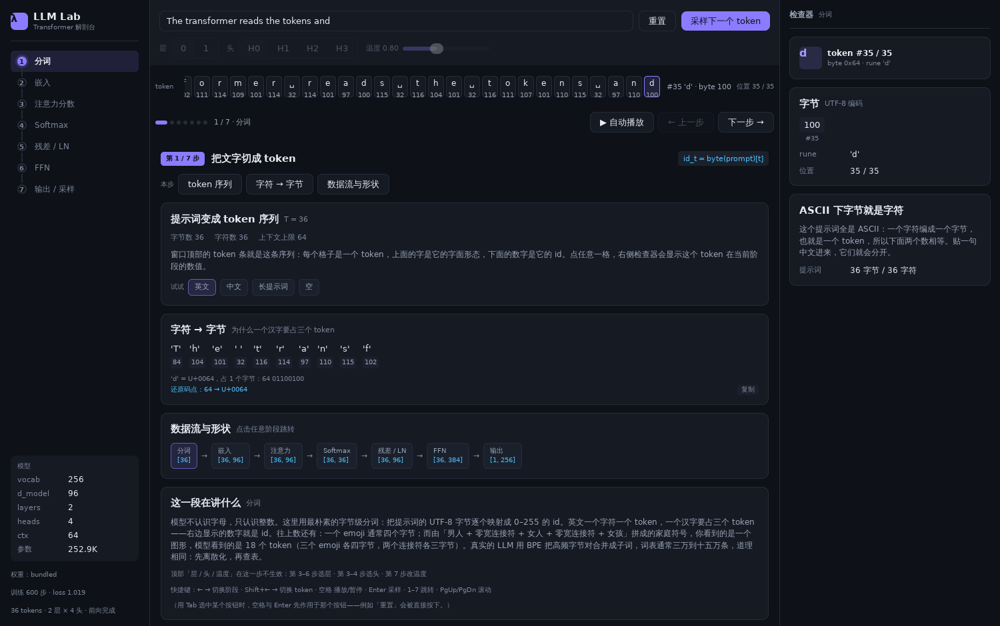
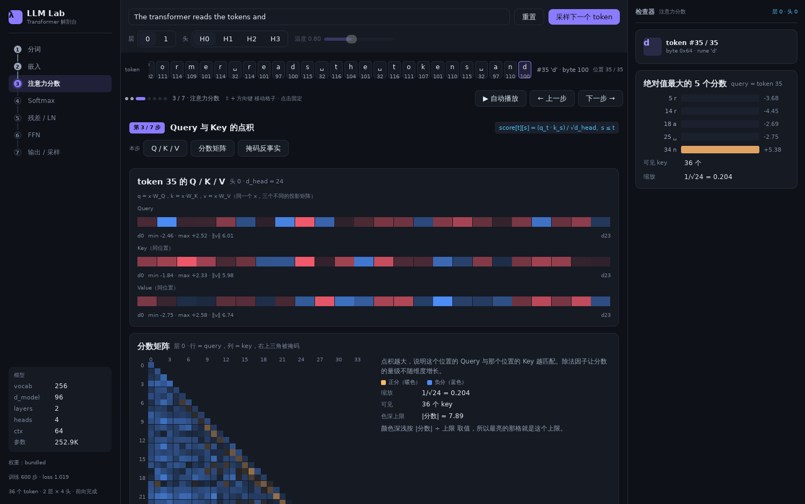
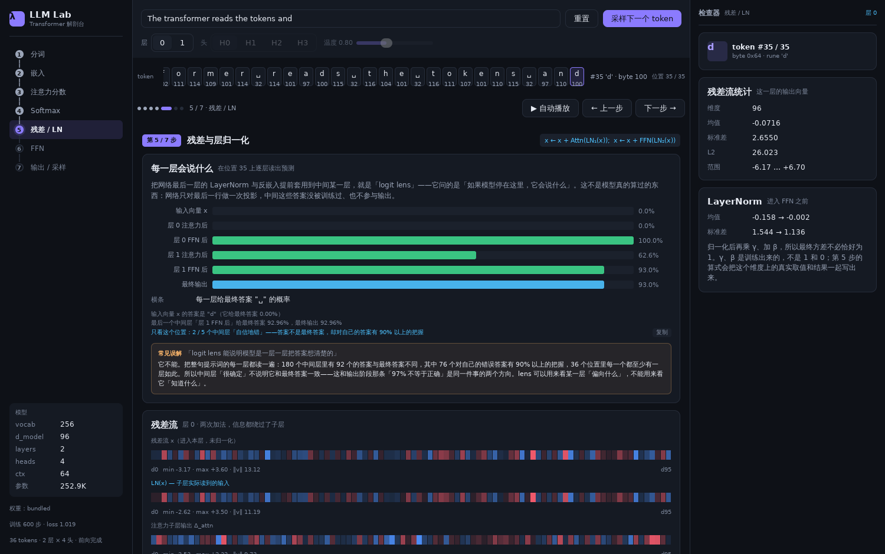
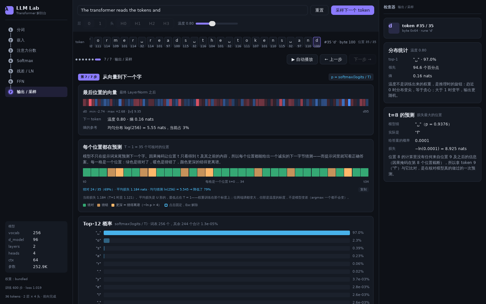
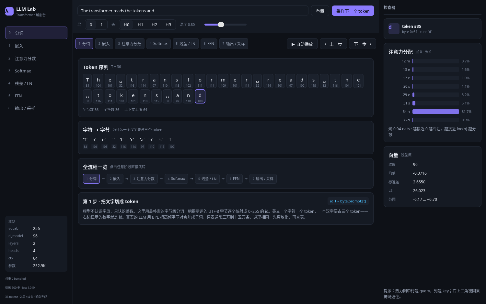

# LLM Lab · Transformer 解剖台

用 **MyGo** 的原生 UI（纯 Go、GPU 绘制、没有 WebView、没有 HTML/JS）写的一个 Transformer 架构学习工具：输入一句话，然后逐层剥开它——分词、嵌入、Q/K/V、注意力矩阵、残差与 LayerNorm、FFN、logits 与采样，每一步都能看到真实的数字。


<details>
<summary>界面一览（点击展开另外五张）</summary>

分词、注意力分数、残差与 LayerNorm、输出采样，以及最小窗口 1180×720 下的同一界面：







</details>

## 为什么用 MyGo

- **一个 Go 二进制就够**：模型、前向计算、界面全在一个进程里，11 MB，没有 Python、没有 Node、没有浏览器内核。
- **界面就是数据**：`view` 是状态的函数，改一个滑块整帧重画，热力图/向量条带用 `ui.Box(...).Draw` 直接画在 GPU 上。
- **秒开**：和 Electron 系的教学工具比，启动时间与内存占用低一个数量级。

## 快速开始

需要 Go 1.27+（go.mod 要求 1.27.3，低版本会自动拉工具链），Linux 上还需要 GTK 3（`sudo apt install libgtk-3-0`）。

```bash
# 直接运行（默认 1500×940）
go run .

# 小屏：可以指定窗口尺寸，最小 1180×720
go run . -w 1180 -h 720

# 开发模式（改代码自动重启）
go tool mygo dev
```

## 多端构建

构建统一走 **just**（[安装](https://github.com/casey/just#installation)：`brew install just` / `winget install Casey.Just` / `scoop install just` / `cargo install just`）：

```bash
just            # 一次性构建 Windows + Linux + macOS
just build      # 同上；也可只构建指定平台
just linux      # linux/amd64 + linux/arm64
just windows    # windows/amd64
just mac        # darwin/universal（Intel + Apple Silicon）
just artifacts  # 列出已有产物与体积
just clean      # 清空 build/
```

默认产物（输出到 `build/<平台>/`）：

| 目标 | 产物 |
| --- | --- |
| `linux/amd64`、`linux/arm64` | 可执行文件、`llm-lab_<ver>_<arch>.deb`、带 `install.sh` 的 `.tar.gz`、`PKGBUILD` |
| `windows/amd64` | `LLM Lab.exe`；在 Windows 上构建时自动补 `LLM Lab-setup-<ver>-amd64.exe`（NSIS） |
| `darwin/universal` | `LLM Lab.app`（同时含 arm64 与 amd64）；在 macOS 上构建时额外产出 `.dmg`，可配置签名/公证 |

MyGo 不依赖 cgo，所以**在任意系统上都能交叉编译三端**，不需要 macOS 机器也能出 `.app`。只有三件事必须在 macOS 本机完成：`.dmg` 打包、Developer ID 签名、公证。Windows 安装包需要 `makensis`，Linux/macOS 上没装就跳过，不影响 exe 本体。

单平台构建不会清掉其他平台的产物，`just linux` 之后 `build/windows-amd64/` 仍在。Windows 上运行 just 需要 Git Bash（justfile 用 bash 作为 shell）。

不想装 just 时，等价命令是：

```bash
go tool mygo build -platform linux/amd64,linux/arm64,windows/amd64,darwin/universal
```

## 开发

```bash
just fmt      # gofmt -w
just check    # gofmt 检查 + go vet + go test（CI 的主要门槛；要完全对齐 CI 用 just check-ci）
```

改模型或界面后的验证标准（对拍、无窗口截图）见 [CONTRIBUTING.md](CONTRIBUTING.md)，版本变更见 [CHANGELOG.md](CHANGELOG.md)。CI 在 Linux/macOS/Windows 三个平台跑测试并各打一次包；推 `v*` tag 会自动建 release 并上传三端安装包。

启动后：

| 操作 | 效果 |
| --- | --- |
| 顶部输入框 | 改提示词，实时重跑前向 |
| 顶栏「撤销」 | 只在有东西可撤时出现，做与 `Ctrl+Z` 相同的事。放在顶栏是因为这一行在七个阶段上都可见——撤销原先只有第 7 步卡片上的一个按钮，而那张卡在 1180×720 下还在视口外 |
| 常驻 token 条 | 七个阶段都在，点一格选中它；热力图悬停时标出 query / key |
| `Shift` + 方向键 | 第 3、4 步在注意力矩阵里移动格子（↑↓ 换 query，←→ 换 key）；其余步骤 `Shift`+`←`/`→` 移动 token 选择 |
| 示例胶囊（英文 / 中文 / 长提示词 / 空） | 一键切换提示词，演示 CJK 与截断 |
| 层分段控件 | 切换观察第几层（第 3–6 步可用，其余阶段置灰） |
| 头分段控件 | 切换观察第几个注意力头（第 3–4 步可用）；检查器会并排列出四个头在这一行的熵，当前头高亮 |
| 温度滑块 | 实时重算 softmax 分布（只在第 7 步生效，其余阶段置灰） |
| 点击 token 胶囊 | 右侧检查器显示该 token 在当前阶段的数值 |
| 悬停热力图单元格 | 显示 (query, key, 分数, 权重)，并把这一格的 softmax 算式写出来 |
| 悬停 / 点击第 7 步的逐位置色带 | 一格一个位置。悬停让右侧检查器描述那一格；点一下固定，再点一次或按 `Esc` 解除。不选时默认描述**损失最大**的那个位置——这张卡要说明的正是「这个模型经常错」，默认落在猜错处比落在 t=0 更有用 |
| 点击热力图单元格 | 固定这一格：指针移开、改提示词后都留在检查器里；再点一次或按 `Esc` 解除。**凡是让这一格不再指同一处**的动作都会解除：切换阶段、切换层、切换头、自动播放推进到下一步、在 token 条里选中另一个 token、以及采样续写（采样会选中新生成的那个 token，也算换行）。理由是格子属于它那一行，换行或换层之后留在检查器里，标题与内容会指向不同的东西 |
| 采样并续写（顶栏同一动作写作「采样下一个 token」） | 按当前温度抽一个 token 追加到提示词，**并自动选中它**——所以采样后 token 条上那个新格子是高亮的，检查器也立刻描述刚生成的那个字节，在哪个阶段都看得到。卡片会显示这次抽样用到的种子与区间。种子只来自提示词文字，所以温度不变时同一句提示词永远得到同一个结果；拖动温度会改变分布形状，同一个种子可能落进另一个区间 |
| `←` / `→` | 上一个 / 下一个阶段 |
| `空格` | 自动播放 / 暂停。每 1.3 秒推进一个阶段，播到第 7 步自动停止；暂停后再按是**从当前步接着播**，不是从头；停在最后一步时按空格会**从第 1 步重新开始**（否则指示灯会亮一下又灭，画面不动） |
| `Enter` | 采样并续写（输入框有焦点时不触发，所以打字不会误采） |
| `Ctrl+Z` | 撤销上一次**替换整句提示词**的动作：换成预设、`重置`、采样续写。提示词、选中的 token、采样记录一起还原，按钮和这行提示都会写明撤销的是哪一次（例如「撤销『换成预设提示词』」）。自己打字**不会**建立撤销点（那样 `Ctrl+Z` 会一个字一个字往回退，是编辑器的行为不是这里的），但也**不会销毁**已有的撤销点——在预设上再打一个字，仍然撤得回原来那句。顶栏「重置」右边的「撤销」按钮做同一件事，鼠标悬停会写明撤销的是哪一次 |
| `1`–`7` | 直接跳到第 N 个阶段 |
| `PageUp` / `PageDown` | 中栏向上 / 向下滚一屏（约 0.9 屏，留一点重叠）。1180×720 下这一列最多有 870 DIP 的内容在视口外——比一整屏还多——而 mygo 默认只把滚动键交给「指针下方或焦点链里」的滚动容器，所以纯键盘读者此前根本够不到 lesson 正文和算式块 |
| `Home` / `End` | 中栏滚到顶部 / 底部 |
| `Esc` | 停止自动播放 |

## 七个阶段与代码的对应关系

每一行写成「界面读的是哪个字段 → 由哪个函数算出 → 写回哪个字段」，字段都在 `model.Trace` 里，界面只是渲染它们。左列可以直接对照界面上的数字。

| 界面阶段 | 公式 | 读 | 函数 | 写回 |
| --- | --- | --- | --- | --- |
| 1 分词 | `id = byte(prompt)` | 提示词字符串 | `tokenizer.go: Tokenize` → `Truncate` | `Trace.Tokens`（每个 UTF-8 字节一个） |
| 2 嵌入 | `x = E[id] + P[t]` | `Weights.TokEmbed`、`PosEmbed` | `Forward` 开头的 `copy` + `addInto` | `Trace.Embed` / `Trace.Pos` / `Trace.Input` |
| 3 Q/K/V 与分数 | `score = q·k / √d_head`，`s ≤ t` | `LayerTrace.Norm1` | `matMulRows`（三个投影）+ `dot`，掩码处写 `-Inf` | `HeadTrace.Q/K/V`、`HeadTrace.Scores` |
| 4 Softmax 与加权 | `α = softmax(score)`，`out = Σ α·v` | `HeadTrace.Scores` | `tensor.go: softmaxCausal`，再逐行加权 `V` | `HeadTrace.Attn`、`HeadTrace.Out` |
| 5 残差 / LN | `x ← x + Attn(LN₁(x))`；`x ← x + FFN(LN₂(x))` | `LayerTrace.In`、`AttnProj`、`FFNOut` | `tensor.go: layerNorm` + `addInto` | `Norm1`、`AfterAttn`、`Norm2`、`AfterFFN` |
| 6 FFN | `W₂ · GELU(W₁ · LN(x))` | `LayerTrace.Norm2` | `matMulRows` → `tensor.go: gelu` → `matMulRows` | `Hidden`（d_ff 宽）、`FFNOut` |
| 7 输出与采样 | `p = softmax(logits / T)` | `LayerTrace.AfterFFN` 的最后一行 | `layerNorm` → 与 `TokEmbed` 点积（权重绑定） | `FinalNorm`、`Logits`；`weights.go: Probabilities` 再按温度做 softmax |
| 7 每个位置的预测 | 第 t 行预测第 t+1 个字节 | `FinalNorm` 的**每一行** | `weights.go: Unembed` + `Softmax` | 卡片现算：`nextByteSkill`（模型不收） |

### 为什么第 5 步多了一张「每一层会说什么」

那张卡是 **logit lens**：网络只在最后一层做一次 LayerNorm 与投影，把这两个提前套用到中间某一层，就能读出「如果模型停在这里，它会说什么」。**它不是模型真的算过的东西**，中间那些答案没被训练过，也不参与输出。放它进来是因为它最能说明「中间层很确定」并不等于「它知道最终答案」：

- 默认提示词、最后一个位置：输入向量与层 0 注意力后的答案都是 `"d"`，到层 0 FFN 后变成 `"␣"` 并给出 100%，层 1 注意力后回落到 62.6%，最终 93.0%——**真正让预测出现的是 FFN，注意力单独不改变答案**
- 把整句提示词的每一层都读一遍：**180 个中间层里有 92 个的答案与最终答案不同**，其中 **76 个对自己的错误答案有 90% 以上的把握**，**36 个位置里每一个**都至少有一层如此
- 图表画的是「这一层给最终答案多少概率」，不是 top-1 概率、也不是熵。后两者是本轮先画的，结果那张图没有信息：这个模型中间层的分布几乎是 one-hot（熵 0.00，对着 ln 256 = 5.55 的天花板），所有条都是一根细丝

最后一格是**该位置**的真实输出：`Trace.Logits` 只存最后一行（`Forward` 只投影那一个位置），所以位置不是末尾时要用 `Unembed(FinalNorm[pos])` 现算——那一行已经过了最终 LayerNorm，因此直接 `Unembed`，不能再调 `LogitLens`（会归一化两次，实测 256 个 logit 全部不同）。`TestLogitLensFinalRungIsTheOutputAtThatPosition` 逐个位置核对，`TestLogitLensAgreesWithThePerPositionCard` 则要求它与第 7 步的逐位置卡片**说出同一个字节**——这两条正是发现上面那个 bug 的测试。

三处容易看漏的细节：

- **头是分开算的**：`HeadProj[h]` 是 `Out_h · Wo[h*d_head:(h+1)*d_head]`，`AttnProj` 就是各头之和，所以第 4 步卡片里「本头贡献」和「全部头相加」是两个不同的量。
- **`-Inf` 是掩码，不是数值**：`Scores` 右上角是 `negInf`，`softmaxCausal` 直接在 `i+1` 处截断，从不真的对它做指数。
- **`Logits` 只有一行，但预测不只有一次**：`FinalNorm` 是 `T × d_model`，`Trace.Logits` 只保存**最后一个位置**的那一行，宽度是词表大小——本模型把 96 维的向量点乘到 `TokEmbed` 的 256 行上，得到 256 个 logit（形状 `[T, 96] → [1, 256]`），所以第 7 步顶上那张卡片看的是「最后一个 token 之后的那个字」。但**每个位置都能预测**，而且前面 T−1 个位置的预测还有答案可核对：提示词里就写着真实的下一字节。第 7 步的「每个位置都在预测」卡片用 `Weights.Unembed` 把每一行投影一遍，逐位置比对，给出猜对率与平均交叉熵（本权重实测 24/35、1.121 nats，对着均匀猜测的 ln 256 = 5.545）。`Unembed` 与 `Forward` 用同一个 float32 累加顺序，所以最后一行的结果与 `Trace.Logits` **逐位相同**，由 `TestUnembedReproducesTheRecordedLogits` 钉住。

每次 `Forward` 会把每个中间张量录进 `model.Trace`（`gpt.go`），界面只读这份缓存——所以拖动滑块、切换层/头都不需要重算整个网络。

### 图上每个元素怎么读

界面里的图形都带参照，不是抽象的色块。下表左列是你在屏幕上看到的东西：

| 元素 | 含义 |
| --- | --- |
| 热力图上下边缘的数字 | 上边是 **key 位置**，左边是 **query 位置**，与 token 条的编号一致；选中行用暖色标出。格子宽度不足 26 DIP 时标签按固定步长稀疏：36 token 的默认提示词在 1500 宽窗口下每 3 个标一次；64 token 的长提示词在 1500/1920 宽下每 4 个标一次，在最小的 1180 宽下矩阵只有 324 DIP、每 6 个标一次。选中行永远标 |
| 第 3 步格子的颜色深浅 | `\|分数\| ÷ 色深上限`，上限是**整张矩阵的最大绝对分数**，卡片里的「色深上限」写着当前值——它随提示词和层变化（本模型实测第 0 层 4.6–12.5、第 1 层 8.1–15.2），不是固定刻度。暖色为正、蓝色为负 |
| 第 4 步格子的颜色深浅 | `α` 经过 `√α` 提亮后的值；`α ≤ 0.0005` 的格子直接画成底色，因为再淡也看不出来 |
| 向量条带的颜色 | 每个格子是一个维度的值，**红色为正、蓝色为负**，颜色越实表示绝对值越大（达到本行最大绝对值时最实），接近 0 的维度几乎融进面板。这套红/蓝和热力图的橙/蓝是两套，别混：热力图的橙表示「分数高」，条带的红只表示「数值为正」——热力图旁边有「正分（暖色）/负分（蓝色）」的图例，条带没有图例，颜色含义就看这一行 |
| 向量条带两端的 `d0` / `d95` | 这条色带覆盖的维度区间。中间那句 `min / max / ‖v‖` 是这一整行的极值与 L2 长度。指针停在条带上时右侧显示光标处那一维的精确值（`d37 = -0.0627`） |
| 直方图的竖线 | 0 的位置。只有当数值范围跨越 0 时才画——第 5 步 LayerNorm 的前后两张图共用一条横轴，所以那条竖线落在两张图的同一处，能直接看出「归一化后以 0 为中心」 |
| 第 5 步两张直方图的**共同横轴** | 两张图刻意使用同一个区间（两行的极值并集）。各自缩放会让收窄一半的分布看起来和原来一样宽 |
| 第 6 步直方图最左的高柱 | 负区被压缩的后果，不是全部数据：本模型一行里 239/384 个负值只分布在 0 左侧 4% 的宽度内。卡片正文写了这个比例，并指向色带看细节 |

侧栏的进度轨用三种状态表示七个阶段：**已完成**（灰点）、**当前**（实心强调色 + 光晕）、**未到**（空心描边），竖线随进度填充。

顶部「层 / 头 / 温度」三个控件只在读取它们的阶段可用，其余阶段置灰；每个阶段的底部会写清这三个控件各自在第几步生效。

切换阶段时中栏和检查器会淡入（160ms）。动效只改不透明度、不动位置，因为这个工具的用法就是在一个固定位置比较两个阶段的数据。系统开启「减少动效」时切换是瞬间完成的，没有过渡帧。

第 2 步的嵌入相加、第 3 步的分数点积、第 4 步的注意力权重与加权求和、第 5 步的残差累加与 LayerNorm、第 6 步的 FFN 求和与第 7 步的采样都会把算式写出来（带当前数据的具体数字），读者可以照着手算并得到卡片上那个值。每段算式的末行右侧有个「复制」：点一下就把这几行（逐行、原样，包括正负号与括号）放进剪贴板，拿去草稿纸或计算器里核对。界面上的文字是画出来的、不可选中，所以在此之前这些数字唯一的搬运方式是用眼睛读出来再手打。

第 3–7 步各带「常见误解」卡片，共七条（第 4 步有两条；第 5 步的 logit lens 那条是「lens 能说明模型一层层把答案想清楚」的反驳）；第 1 步在含多字节字符的提示词下还会多一条（「一个汉字就是一个 token」的纠正，纯 ASCII 提示词下不出现）：先写出画面上最容易得出的错误读法，再用**当前提示词下这个模型真实算出来的数字**纠正它（分数的平移不变性、列和不受约束、各头贡献不能直接相加、GELU 的负输出下界、概率高不等于正确）。这些数字每次都从 `Trace` 现算，换提示词、换权重都会跟着变。

## 模型

内置的是一个**字符/字节级微型 GPT**，参数量 25.3 万：

```
vocab 256 · d_model 96 · 2 层 · 4 头 · d_ff 384 · ctx 64
```

权重由 `tools/train.py` 用 PyTorch（CPU，约 45 秒）在 61 句关于 Transformer 的英文句子训练 600 步得到，导出为 `internal/model/weights.json` 并 `go:embed` 进二进制。

```bash
python3 tools/train.py                 # 复现权重
python3 tools/train.py --steps 2000    # 更收敛、分布更尖
go run . -weights /path/to/other.json  # 换一份权重（需为 vocab 256 的 byte-level 同架构）
```

模型输出的是「像语料但不是语料」的英文，这一点是刻意的：这是一个观察数值流动的工具，不是一个能聊天的模型。

## 正确性

`go test ./...` 覆盖：

- softmax 每行和为 1、因果掩码让上三角严格为 0、LayerNorm 输出零均值单位方差
- 同一输入两次前向结果逐位一致
- tokenizer 中英文往返一致；截断不会切在多字节字符中间
- **逐张量与 PyTorch 对齐**：`tools/parity.py` 把同一份 `weights.json` 在 PyTorch 里跑一遍，导出 46 token 提示词的全部中间结果（embedding、每层 Norm1、每个头的 Q/K/V、score、attn、头输出、AttnProj、Norm2、GELU 前后、FFN 输出、最终 Norm、logits），Go 侧 `TestParityEveryTensor` 逐项比对，中间张量最大误差 3e-6，logits 1.6e-5——logit 是 256 项点积的和，误差在最后一步被放大。GELU 与 softmax 的 exp 都用查表近似，误差分别 ≤ 4e-7、2.4e-6，由 `TestGeluMatchesErf`、`TestExpNegMatchesExp` 锁定；标量与 SIMD 构建结果一致。这比只比最终 logits 严格得多：头切片顺序、拼接布局、GELU 变体、LayerNorm 的 eps 出错都会被抓到
- 单头贡献之和严格等于该层的注意力输出（`TestHeadProjSumsToAttnProj`），界面上「本头贡献 Δ_h」不是拿总和冒充的
- **逐位置预测与记录下来的 logits 逐位一致**：第 7 步的逐位置卡片用 `Weights.Unembed` 重新投影每一行，`TestUnembedReproducesTheRecordedLogits` 要求它对最后一行的结果与 `Forward` 存进 `Trace.Logits` 的值**每个 bit 都相同**——否则同一张卡片上两个数会不一致
- **逐位置卡片报的损失不是编的**：`TestNextByteSkillMatchesTheModel` 逐位置核对「猜的是自己那一行的 argmax」「比对的是提示词的下一个字节」「损失就是 −ln p(正确字节)」；`TestNextByteSkillLossIsReal` 要求平均损失确实低于均匀猜测的 ln 256，且既不是全对也不是全错（否则色带只有一个颜色）。`TestNextByteSkillIsCalibratedAtTOne` 钉住一个反直觉的实测结果：平均损失对温度是 **U 形**的，最低点在 T = 1，往两端都变大——所以卡片必须说明这个数字随滑块移动，而不是模型变差了
- 用 `ui.Tester` 模拟真实点击，验证阶段切换

界面本身也能在没有窗口的情况下渲染成 PNG（`ui.Render`）：`RENDER=1 go test ./internal/app -run 'TestRenderSteps|TestRenderSizes'` 会把七个阶段、1180/1500/1920 三种窗口宽度、以及 64 token 长提示词的截图写到 `/tmp`，用于回归检查布局与溢出。加 `RENDER_DIR=<目录>` 可改输出位置（目录不存在会自动创建）——对比改动前后时把它指向两个目录，否则两次渲染会覆盖同一批文件。

性能（AMD EPYC 7742，Go 1.27，单核 / 4 核）：前向 16 token 1.4 / 1.2 ms、64 token 6.2 / 2.4 ms；用实验性 SIMD 构建（`just build-simd`，Go 1.27 的 `simd` 包，amd64 走 AVX、arm64 走 NEON）后 16 token 0.53 / 0.46 ms、64 token 2.5 / 1.4 ms。矩阵乘按行、注意力按头并行，最多 8 个 worker；整帧 `ui.Render` 1500×940 ≈ 9.4 ms（CPU 光栅化，热力图只画因果掩码内的格子）。基准：`just bench`、`just bench-simd`。

## 已知限制

- 权重很小，输出质量只够演示；中文输入可以分词和可视化，但模型没在中文上训练，续写没有意义
- 只实现了前向传播，没有反向传播和训练过程可视化
- 上下文 64 token，超出后截断到最近 64 个（左侧栏状态行会提示）；截断会前进到 UTF-8 字符边界，不会从半个汉字开始
- 注意力矩阵的数值用鼠标悬停或键盘查看；键盘覆盖阶段切换、播放、跳转、token 选择、在矩阵里移动格子、滚动中栏，以及撤销采样
- **token 条超出视口后只能用指针拖**：它横向滚动、不画滚动条，键盘没有横向滚动键（`←`/`→` 是阶段切换），滚轮的垂直方向也不会带动它。纯键盘读者仍然能走完整条序列——`Shift+←/→` 移动选中项时，选中那格会被滚进视野（`RevealRail` → `ScrollIntoView`，实测走 63→48 时格子从 x=657 移到 x=277，始终在窗口内）；但「先点某一格再看它」在长提示词下得先把指针移过去
- **数字只能整段复制**：每段算式有一个「复制」按钮，但没有文本选中，所以不能只挑一个数字或一行。要单个数值时得先复制整段再删
- **方括号焦点会先吃掉空格与 Enter**：用 Tab 选中某个按钮之后，这两个键先作用于那个按钮（例如选中「重置」时按 Enter 就是按下它），而不是播放/采样。这是对的行为——读者刚用 Tab 选中了它——但 lesson 下方的快捷键行会附一句说明
- 读不到内置权重时 `main.go` 会退回随机权重继续启动，此时界面照常可用、图形也照常成立，但输出没有意义——顶栏会挂一条橙色横幅，侧栏也会标「未训练」
- Linux 上若无 GPU，MyGo 会退回 CPU 绘制（日志提示 `native UI draws without the GPU`），界面功能不受影响

## 目录

```
main.go                  窗口与权重加载
justfile                 多端构建、测试、运行命令
internal/model/          纯 Go 模型：tokenizer / tensor / gpt / weights
internal/model/testdata/ PyTorch 逐层对拍夹具（parity.json.gz）
internal/app/            MyGo 界面：布局、组件、七个阶段的视图、检查器（theme.go 有调色板与字号阶梯）
tools/train.py           PyTorch 训练并导出 weights.json
tools/parity.py          PyTorch 逐层中间结果导出，用于对拍
docs/                    截图
.github/                 CI、release、dependabot 配置
.vscode/                 共享的编辑器配置与调试配置
```

仓库约定：LF 换行 + `.editorconfig` 缩进（Go 用 tab，justfile 4 空格），
`weights.json` 与对拍夹具在 diff 与语言统计中折叠，构建产物不入库。
