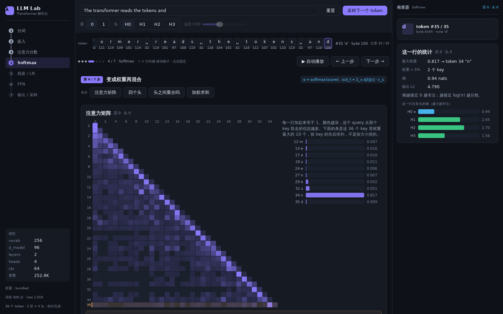
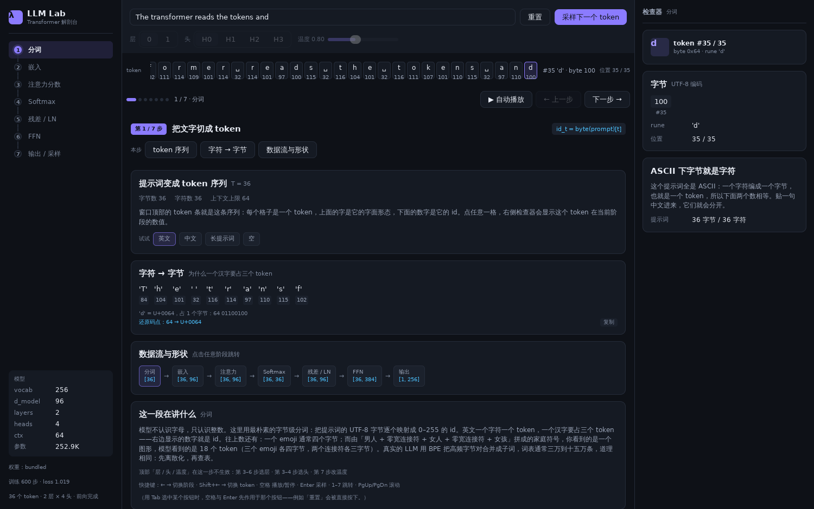
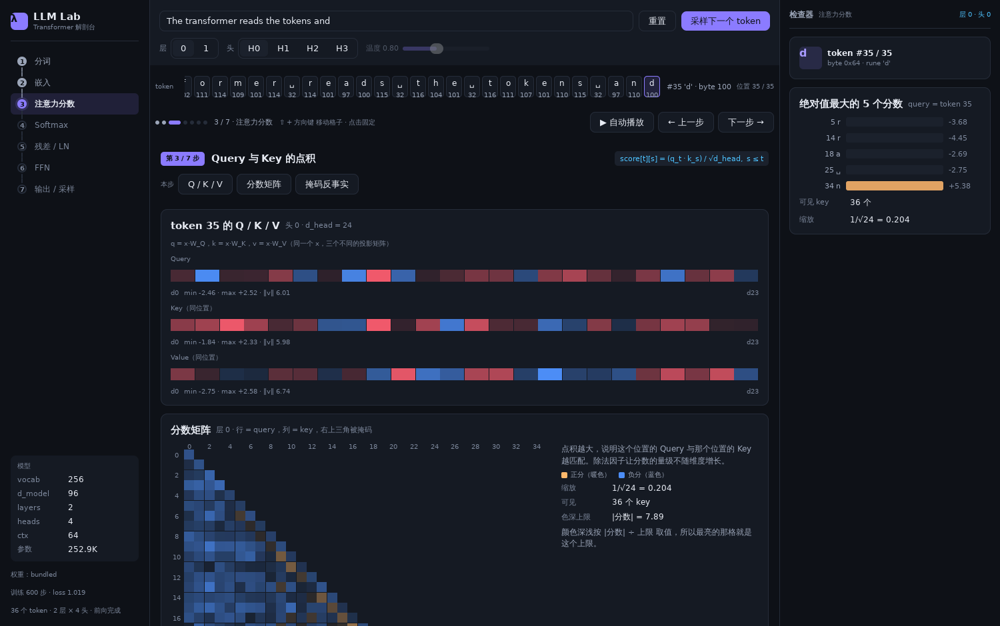
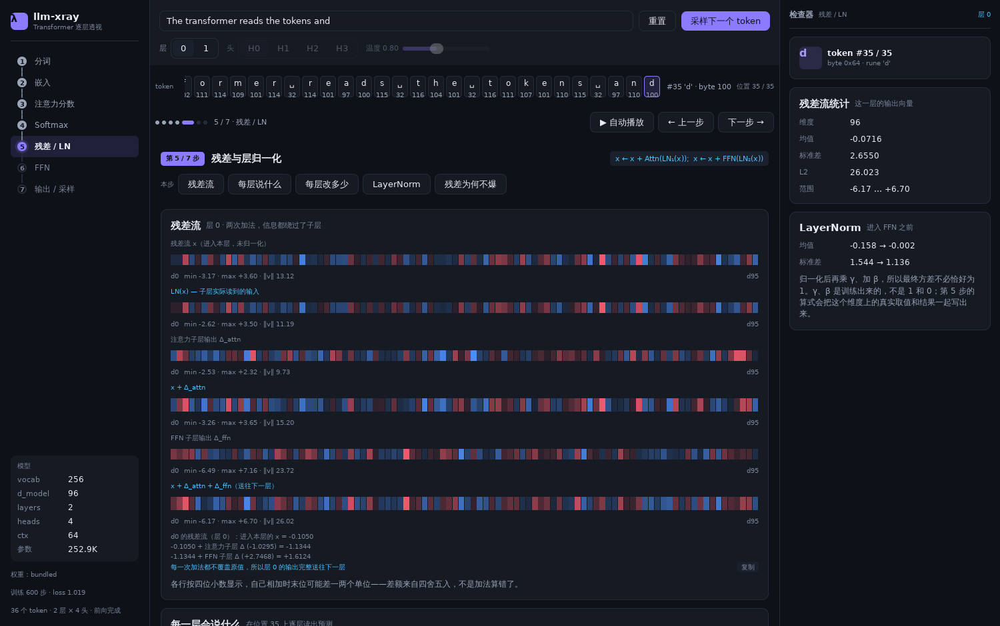
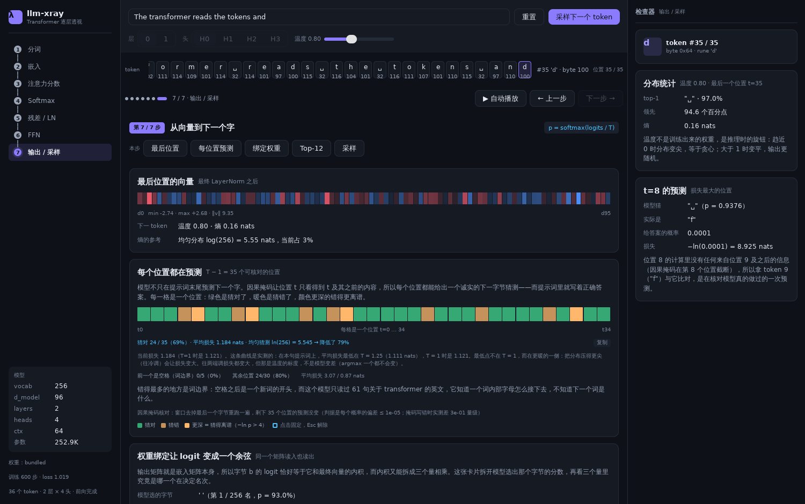
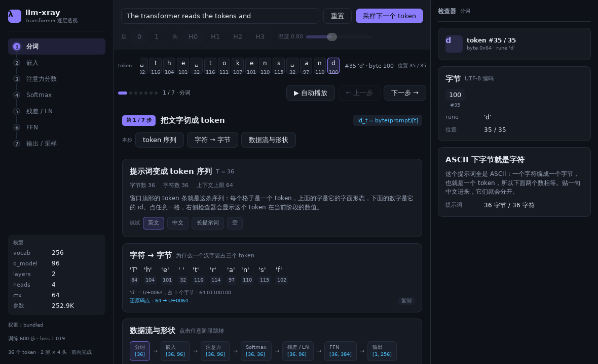

# llm-xray · Transformer 逐层透视

用 **MyGo** 的原生 UI（纯 Go、GPU 绘制、没有 WebView、没有 HTML/JS）写的一个 Transformer 架构学习工具：输入一句话，然后逐层看进去——分词、嵌入、Q/K/V、注意力矩阵、残差与 LayerNorm、FFN、logits 与采样，每一步都能看到真实的数字。

同一份代码也跑在 iPhone、iPad 和 Android 上：手机与平板用一栏布局（阶段列表收进浮层、检查器移到课程下方），界面在 375 DIP 宽也能读，见[手机与平板](#手机与平板)。



<details>
<summary>界面一览（点击展开另外五张）</summary>

分词、注意力分数、残差与 LayerNorm、输出采样，以及最小窗口 1180×720 下的同一界面：







</details>

## 为什么用 MyGo

- **一个 Go 二进制就够**：模型、前向计算、界面全在一个进程里，12 MB（Linux amd64，含 2.3 MB 的权重），没有 Python、没有 Node、没有浏览器内核。
- **界面就是数据**：`view` 是状态的函数，改一个滑块整帧重画，热力图/向量条带用 `ui.Box(...).Draw` 直接画在 GPU 上。
- **秒开**：和 Electron 系的教学工具比，启动时间与内存占用低一个数量级。

## 快速开始

需要 Go 1.27+（go.mod 要求 1.27.3，低版本会自动拉工具链），Linux 上还需要 GTK 3（`sudo apt install libgtk-3-0`）。

```bash
# 直接运行（默认 1500×940）
go run .

# 小屏：可以指定窗口尺寸，最小 1180×720
go run . -w 1180 -h 720

# 直接打开某一步（0-6，对应七个阶段）
go run . -step 6

# 开发模式（改代码自动重启）
go tool mygo dev

# 手机：iOS 模拟器 / 插着的 Android 设备或模拟器
go tool mygo dev -platform ios
go tool mygo dev -platform android
```

`-w` / `-h` 会被夹到不小于 1180×720，因为布局只在这个尺寸以上验证过——但夹取时会在 stderr 上打一行说明实际用的尺寸，不会默默换掉你要的尺寸；`-step` 则**校验而不是夹取**——写一个不存在的步数会直接退出并列出 0-6 的合法值与每一步的名字，而不是默默打开第一步。两者的区别是有意的：小窗口的意图在 1180×720 上仍然成立，而「打开第 99 步」没有任何合法解释。

## 多端构建

构建统一走 **just**（[安装](https://github.com/casey/just#installation)：`brew install just` / `winget install Casey.Just` / `scoop install just` / `cargo install just`）：

```bash
just            # 一次性构建 Windows + Linux + macOS
just build      # 同上；也可只构建指定平台
just linux      # linux/amd64 + linux/arm64
just windows    # windows/amd64
just mac        # darwin/universal（Intel + Apple Silicon）
just mobile     # iOS 模拟器包 + Android .apk/.aab（arm64）
just artifacts  # 列出已有产物与体积
just clean      # 清空 build/
```

默认产物（输出到 `build/<平台>/`）：

| 目标 | 产物 |
| --- | --- |
| `linux/amd64`、`linux/arm64` | 可执行文件、`llm-xray_<ver>_<arch>.deb`、带 `install.sh` 的 `.tar.gz`、`PKGBUILD` |
| `windows/amd64` | `llm-xray.exe`；在 Windows 上构建时自动补 `llm-xray-setup-<ver>-amd64.exe`（NSIS） |
| `darwin/universal` | `llm-xray.app`（同时含 arm64 与 amd64）；在 macOS 上构建时额外产出 `.dmg`，可配置签名/公证 |
| `android/arm64` | `llm-xray-<ver>.apk` 与 `llm-xray-<ver>.aab`（Play 用后者）；默认用调试密钥签名，见[手机与平板](#手机与平板) |
| `ios/simulator` | 模拟器用的 `llm-xray.app`；真机与 App Store 要 `-platform ios`，另需签名身份与描述文件 |

MyGo 不依赖 cgo，所以**在任意系统上都能交叉编译三端**，不需要 macOS 机器也能出 `.app`。只有三件事必须在 macOS 本机完成：`.dmg` 打包、Developer ID 签名、公证。Windows 安装包需要 `makensis`，Linux/macOS 上没装就跳过，不影响 exe 本体。

单平台构建不会清掉其他平台的产物，`just linux` 之后 `build/windows-amd64/` 仍在。Windows 上运行 just 需要 Git Bash（justfile 用 bash 作为 shell）。

不想装 just 时，等价命令是：

```bash
go tool mygo build -platform linux/amd64,linux/arm64,windows/amd64,darwin/universal
```

## 手机与平板

同一份 `ui.View` 跑在 iPhone、iPad 和 Android 上（MyGo v0.10 起支持，v0.9.1 及更早没有 `internal/mobile`）。手机要各自的原生工具链，所以它们是**显式目标**，不进默认构建：

| 平台 | 需要 | 命令 |
| --- | --- | --- |
| iOS 模拟器 | macOS + Xcode | `just ios` / `go tool mygo dev -platform ios` |
| iPhone、iPad、App Store | 以上 + Apple 开发者团队与描述文件 | `go tool mygo build -platform ios`，再 `go tool mygo publish -platform ios` |
| Android | SDK + NDK + JDK 17（任意系统，`ANDROID_HOME` / `ANDROID_NDK_HOME`） | `just android` / `go tool mygo dev -platform android` |

`go tool mygo doctor` 会逐项检查这些，缺什么就说什么，不会因为桌面构建不需要它们而失败。

**布局在手机上换了一套。** 三栏（阶段列表 / 课程 / 检查器）要 1180 DIP 才摆得下，而手机是 375–430 DIP、竖屏平板是 744–1024 DIP，所以在 `CompactWidth`（= 桌面最小宽度 1180）以下换成单栏：阶段列表变成顶栏「☰ 阶段」打开的浮层，检查器接在课程下方，步骤条只留进度点和「← / ▶ / →」——手机没有方向键，那三个按钮是唯一的换步方式。两个布局共用同一个 `View`、同一份状态、同一批卡片，差别只在摆放。

`main.go` 的 `-w` / `-h` 仍然夹到 1180×720：那是**桌面**布局的下限，手机的窗口尺寸由系统给，走的是单栏布局。两个分支都有渲染测试盯着：桌面 1180–1920，手机 375–1024（`internal/app/compact_test.go`）。

**默认签名是调试密钥**，Google Play 会拒绝。要发版就在 `mygo.json` 里配 `android.keystore` / `keyAlias`，密码从 `MYGO_ANDROID_KEYSTORE_PASSWORD` 和 `MYGO_ANDROID_KEY_PASSWORD` 读；iOS 侧的签名与公证见 MyGo 自己的 `docs/mobile/building.md`。

## 开发

```bash
just fmt      # gofmt -w
just check    # gofmt 检查 + go vet + go test（CI 的主要门槛；要完全对齐 CI 用 just check-ci）
```

改模型或界面后的验证标准（对拍、无窗口截图）见 [CONTRIBUTING.md](CONTRIBUTING.md)，版本变更见 [CHANGELOG.md](CHANGELOG.md)。CI 在 Linux/macOS/Windows 三个平台跑测试并各打一次包；推 `v*` tag 会自动建 release 并上传三端安装包。

启动后：

| 操作 | 效果 |
| --- | --- |
| 顶部输入框 | 改提示词，实时重跑前向 |
| 顶栏「撤销」 | 撤销上一次整句换提示词（换成预设、`重置`、采样续写），等价于 `Ctrl+Z` |
| 「本步」卡片索引 | 列出本阶段的每张卡片，点一下跳到那张；随滚动吸顶。七个阶段目前都至少有三张，所以每步都有这一行 |
| 常驻 token 条 | 七个阶段都在，点一格选中它；热力图悬停时标出 query / key |
| 层分段控件 | 切换观察第几层（第 3–6 步），其余阶段置灰 |
| 头分段控件 | 切换观察第几个注意力头（第 3–4 步），其余阶段置灰 |
| 温度滑块 | 实时重算 softmax 分布（只在第 7 步生效），其余阶段置灰 |
| 示例胶囊 | 一键切换提示词：英文 / 中文 / 长提示词 / 空 |
| 采样并续写（顶栏写作「采样下一个 token」） | 按当前温度抽一个字节追加到提示词并自动选中它（等价于 `Enter`）。**温度不变时**同一句提示词永远得到同一个结果；拖动温度会改变分布形状，同一个种子可能落进另一个区间 |
| 悬停热力图单元格 | 显示 (query, key, 分数, 权重)，并写出这一格的 softmax 算式 |
| 点击热力图单元格 | 固定这一格，再点一次或按 `Esc` 解除。**凡是让这一格不再指同一处**的动作都会解除：切换阶段、切换层、切换头、自动播放推进、选中另一个 token、采样续写 |
| 悬停 / 点击第 7 步逐位置色带 | 一格一个位置：悬停描述，点击固定；未选时默认描述损失最大的那个位置 |
| `←` / `→` | 上一个 / 下一个阶段 |
| `1`–`7` | 直接跳到第 N 个阶段 |
| `Shift` + 方向键 | 第 3、4 步在矩阵里移动格子（↑↓ 换 query，←→ 换 key）；其余步骤移动 token 选择 |
| `空格` | 自动播放 / 暂停（每 1.3 秒一步，播到第 7 步停止） |
| `Enter` | 采样并续写（输入框有焦点时不触发） |
| `Ctrl+Z` | 撤销上一次整句换提示词；自己打字不会建立撤销点 |
| `PageUp` / `PageDown` | 中栏向上 / 向下滚一屏。1180×720 下这一列最高的一步有**两个半屏以上**的内容在视口外 |
| `Home` / `End` | 中栏滚到顶部 / 底部 |
| `Esc` | 停止自动播放、解除固定的热力图格子与逐位置预测 |

这些交互为什么这样设计——撤销为何在顶栏、卡片索引为何吸顶、固定格子为何在换层时解除——见 **[docs/keys.md](docs/keys.md)**。

## 七个阶段与代码的对应关系

每一行写成「界面读的是哪个字段 → 由哪个函数算出 → 写回哪个字段」，字段都在 `model.Trace` 里，界面只是渲染它们。左列可以直接对照界面上的数字。

| 界面阶段 | 公式 | 读 | 函数 | 写回 |
| --- | --- | --- | --- | --- |
| 1 分词 | `id = byte(prompt)` | 提示词字符串 | `tokenizer.go: Tokenize` → `Truncate` | `Trace.Tokens`（每个 UTF-8 字节一个） |
| 2 嵌入 | `x = E[id] + P[t]` | `Weights.TokEmbed`、`PosEmbed` | `Forward` 开头的 `copy` + `addInto` | `Trace.Embed` / `Trace.Pos` / `Trace.Input` |
| 3 Q/K/V 与分数 | `score = q·k / √d_head`，`s ≤ t` | `LayerTrace.Norm1` | `matMulRows`（三个投影）+ `dot`，掩码处写 `-Inf` | `HeadTrace.Q/K/V`、`HeadTrace.Scores` |
| 4 Softmax 与加权 | `α = softmax(score)`，`out = Σ α·v` | `HeadTrace.Scores` | `tensor.go: softmaxCausal`，再逐行加权 `V` | `HeadTrace.Attn`、`HeadTrace.Out` |
| 5 残差 / LN | `x ← x + Attn(LN₁(x))`；`x ← x + FFN(LN₂(x))` | `LayerTrace.In`、`AttnProj`、`FFNOut` | `tensor.go: layerNorm` + `addInto` | `Norm1`、`AfterAttn`、`Norm2`、`AfterFFN` |
| 6 FFN | `W₂ · GELU(W₁ · LN(x))` | `LayerTrace.Norm2` | `matMulRows` → `tensor.go: gelu` → `matMulRows` | `Hidden`（d_ff 宽）、`FFNOut` |
| 7 输出与采样 | `p = softmax(logits / T)` | `LayerTrace.AfterFFN` 的最后一行 | `layerNorm` → 与 `TokEmbed` 点积（权重绑定） | `FinalNorm`、`Logits`；`weights.go: Probabilities` 再按温度做 softmax |
| 7 每个位置的预测 | 第 t 行预测第 t+1 个字节 | `FinalNorm` 的**每一行** | `weights.go: Unembed` + `Softmax` | 卡片现算：`nextByteSkill`（模型不收） |
| 4 四个头各自在做什么 | 每个头整句的平均行为 | 每层全部 `HeadTrace.Attn` | `workings.go: computeHeadProfiles` | 卡片现算（模型不收） |
| 4 头之间重合吗 | 各头投影输出两两余弦 | 每层 `HeadProj`（4 × T × d_model） | `workings.go: computeHeadIndependence` | 卡片现算（模型不收） |
| 7 绑定权重 | logit 的三个因子 | `Weights.TokEmbed`（同一矩阵当输出用）+ `FinalNorm` | `workings.go: computeWeightTying` | 卡片现算（模型不收） |
| 2 嵌入有含义吗 | 嵌入空间有没有结构 | `Weights.TokEmbed` | `workings.go: computeEmbeddingStructure` | 卡片现算（模型不收） |
| 2 学出来的位置长什么样 | 位置表 vs 固定正弦编码 | `Weights.PosEmbed` | `workings.go: computePosEncodingShape` | 卡片现算（模型不收） |
| 6 FFN 写出了答案 | FFN 输出与真实下一字节的余弦排名 | 每层 `In`、`FFNOut` + `TokEmbed` | `workings.go: computeFFNAnswerDirection` | 卡片现算（模型不收） |
| 6 单元是怎么分工的 | 每层 FFN 的集中程度 | 每层 `Hidden`（T × d_ff） | `workings.go: computeFFNConcentration` | 卡片现算（模型不收） |
| 5 每一层改写了多少 | 每层对残差流的改动量 | 每层 `In`、`AttnProj`、`FFNOut`、`AfterFFN` | `workings.go: computeLayerRewrite` | 卡片现算（模型不收） |
| 3 掩码挡掉了什么 | 去掉掩码后这一行会看哪 | 该头 `Q`、`K`（`Scores` 上三角是 -Inf，不能反读） | `workings.go: computeMaskCounterfactual` | 卡片现算（模型不收） |

## 卡片量到了什么

七个阶段之外还有八张「多问了一步」的卡片，回答的是几个靠「打开界面看一眼」答不了的结构问题——四个头是否真的分工、因果掩码究竟挡掉了什么、答案是在哪一层写进去的、学出来的位置编码和 sin/cos 差多远。每条结论都有当前权重下算出来的数字，并附上支撑它的测试。

完整测量记录见 **[docs/cards.md](docs/cards.md)**。

## 图上每个元素怎么读

界面里的图形都带参照，不是抽象的色块。下表左列是你在屏幕上看到的东西：

| 元素 | 含义 |
| --- | --- |
| 热力图上下边缘的数字 | 上边是 **key 位置**，左边是 **query 位置**，与 token 条的编号一致；选中行用暖色标出。格子宽度不足 26 DIP 时标签按固定步长稀疏：36 token 的默认提示词在 1500 宽窗口下每 3 个标一次；64 token 的长提示词在 1500/1920 宽下每 4 个标一次，在最小的 1180 宽下矩阵只有 324 DIP、每 6 个标一次。选中行永远标 |
| 第 3 步格子的颜色深浅 | `\|分数\| ÷ 色深上限`，上限是**整张矩阵的最大绝对分数**，卡片里的「色深上限」写着当前值——它随提示词和层变化（本模型实测第 0 层 4.6–12.5、第 1 层 8.1–15.2），不是固定刻度。暖色为正、蓝色为负 |
| 第 4 步格子的颜色深浅 | `α` 经过 `√α` 提亮后的值；`α ≤ 0.0005` 的格子直接画成底色，因为再淡也看不出来 |
| 向量条带的颜色 | 每个格子是一个维度的值，**红色为正、蓝色为负**，颜色越实表示绝对值越大（达到本行最大绝对值时最实），接近 0 的维度几乎融进面板。这套红/蓝和热力图的橙/蓝是两套，别混：热力图的橙表示「分数高」，条带的红只表示「数值为正」——热力图旁边有「正分（暖色）/负分（蓝色）」的图例，条带没有图例，颜色含义就看这一行 |
| 向量条带两端的 `d0` / `d95` | 这条色带覆盖的维度区间。中间那句 `min / max / ‖v‖` 是这一整行的极值与 L2 长度。指针停在条带上时右侧显示光标处那一维的精确值（`d37 = -0.0627`） |
| 直方图的竖线 | 0 的位置。只有当数值范围跨越 0 时才画——第 5 步 LayerNorm 的前后两张图共用一条横轴，所以那条竖线落在两张图的同一处，能直接看出「归一化后以 0 为中心」 |
| 第 5 步两张直方图的**共同横轴** | 两张图刻意使用同一个区间（两行的极值并集）。各自缩放会让收窄一半的分布看起来和原来一样宽 |
| 第 6 步直方图最左的高柱 | 负区被压缩的后果，不是全部数据：本模型一行里 239/384 个负值只分布在 0 左侧 4% 的宽度内。卡片正文写了这个比例，并指向色带看细节 |

侧栏的进度轨用三种状态表示七个阶段：**已完成**（灰点）、**当前**（实心强调色 + 光晕）、**未到**（空心描边），竖线随进度填充。

顶部「层 / 头 / 温度」三个控件只在读取它们的阶段可用，其余阶段置灰；每个阶段的底部会写清这三个控件各自在第几步生效。

切换阶段时中栏和检查器会淡入（160ms）。动效只改不透明度、不动位置，因为这个工具的用法就是在一个固定位置比较两个阶段的数据。系统开启「减少动效」时切换是瞬间完成的，没有过渡帧。

七个阶段的算式都会写出来（带当前数据的具体数字），读者可以照着手算并得到卡片上那个值：

- 第 2 步嵌入相加、第 3 步分数点积、第 4 步注意力权重与加权求和
- 第 5 步残差累加与 LayerNorm、第 6 步 FFN 求和、第 7 步采样

每段算式末行右侧有个「复制」，点一下就把这几行（逐行、原样，包括正负号与括号）放进剪贴板。界面上的文字是画出来的、不可选中，所以在此之前这些数字唯一的搬运方式是用眼睛读出来再手打。

第 2–7 步各带「常见误解」卡片，共十五条：第 2 步两条、第 3 步两条、第 4、5、6 步各三条、第 7 步两条；第 1 步在含多字节字符的提示词下还会多一条。每一条都先写出画面上最容易得出的错误读法，再用**当前提示词下这个模型真实算出来的数字**纠正它。例如「四个头各写一块，加起来就是它们长度的和」（范数不能直接相加）、「每一层做同样多的活，层数加倍的模型就是把同一个变换做两遍」、「残差是加法，所以每加一次，数值就更大一点」、「logit lens 能说明模型是一层一层把答案想清楚的」。全部十五条见 [docs/cards.md](docs/cards.md)。

## 模型

内置的是一个**字符/字节级微型 GPT**，参数量 25.3 万：

```
vocab 256 · d_model 96 · 2 层 · 4 头 · d_ff 384 · ctx 64
```

权重由 `tools/train.py` 用 PyTorch（CPU，约 45 秒）在 61 句关于 Transformer 的英文句子训练 600 步得到，导出为 `internal/model/weights.json` 并 `go:embed` 进二进制。

```bash
python3 tools/train.py                 # 复现权重
python3 tools/train.py --steps 2000    # 更收敛、分布更尖
go run . -weights /path/to/other.json  # 换一份权重（需为 vocab 256 的 byte-level 同架构）
```

模型输出的是「像语料但不是语料」的英文，这一点是刻意的：这是一个观察数值流动的工具，不是一个能聊天的模型。

## 正确性

`go test ./...` 覆盖：

- softmax 每行和为 1、因果掩码让上三角严格为 0、LayerNorm 输出零均值单位方差
- 同一输入两次前向结果逐位一致；tokenizer 中英文往返一致，截断不会切在多字节字符中间
- **逐张量与 PyTorch 对拍**：`tools/parity.py` 把同一份权重跑一遍，导出 46 token 提示词的全部中间张量，Go 侧逐项比对。中间张量最大误差 3e-6，logits 1.6e-5（256 项点积，误差在最后一步放大）。这比只比最终 logits 严格得多——头切片顺序、拼接布局、GELU 变体、LayerNorm 的 eps 出错都会被抓到
- **单头贡献之和等于该层注意力输出**，界面上「本头贡献 Δ_h」不是拿总和冒充的
- **逐位置预测与记录的 logits 逐位一致**：卡片用 `Unembed` 重新投影每一行，最后一行的结果与 `Forward` 存下的值每个 bit 相同
- **因果掩码那句话有后果可看**：去掉窗口最后一个字节重跑前向，前面每个位置的 argmax 一个不变（默认提示词 35/35）。掩码写错时别的图全都还是对的——多看了 key 的那一行照样和为 1、照样画出一个三角形，所以这一条值得单独量
- **误差集中在词边界，而且这一点有分解依据**：输出阶段把逐位置的成绩按「前一个字节是不是空格」拆开。实测默认提示词、默认温度（T = 0.80）：空格之后猜对 **0/5（0%）**，其余位置 **24/30（80%）**，两边的平均损失 **3.07 vs 0.87 nats**。原因是结构性的：空格之后是新词的开头，而这个模型只读过 61 句关于 transformer 的英文——它知道词内部字母怎么接下去，不知道下一个词是什么
- 用 `ui.Tester` 模拟真实点击，验证阶段切换与交互

标量与 SIMD 构建**除末位舍入外一致**（argmax 逐个相同），判据是容差而不是「逐位相同」——这是量出来的，原因见 [CONTRIBUTING.md](CONTRIBUTING.md)。

界面本身也能在没有窗口的情况下渲染成 PNG：`RENDER=1 go test ./internal/app -run 'TestRenderSteps|TestRenderSizes'` 会把七个阶段、三种窗口宽度、64 token 长提示词的截图写到 `/tmp`，加 `RENDER_DIR=<目录>` 可改输出位置。

### 性能

AMD EPYC 7742，Go 1.27，单核 / 4 核：前向 16 token 1.4 / 1.2 ms、64 token 6.2 / 2.6 ms；SIMD 构建（`just build-simd`，amd64 走 AVX、arm64 走 NEON）后 16 token 0.52 / 0.51 ms、64 token 2.5 / 1.6 ms。矩阵乘按行、注意力按头并行，最多 8 个 worker。基准用 `just bench-cores`；`just bench` / `just bench-simd` 适合和自己的改动前后对比。

整帧 `ui.Render` 1500×940 曾测得 13.6 ms（MyGo v0.8.3）。从 MyGo v0.9.1 起（v0.10.0 仍如此），**新建窗口的首帧**要为一套新的文字系统付出代价：同一份 view 的首帧 13.2 ms → 50.3 ms，**同一窗口的第二帧起不变**（0.91 → 0.96 ms）。测试里每个 tester 都是一次新窗口，所以 `just check-ci` 的 SIMD 那一步从 216 s 涨到约 380 s。完整实测与上游问题报告见 [docs/mygo-first-frame-regression.md](docs/mygo-first-frame-regression.md)。

## 已知限制

- 权重很小，输出质量只够演示；中文输入可以分词和可视化，但模型没在中文上训练，续写没有意义
- 只实现了前向传播，没有反向传播和训练过程可视化
- 上下文 64 token，超出后截断到最近 64 个（左侧栏状态行会提示）；截断会前进到 UTF-8 字符边界，不会从半个汉字开始
- 注意力矩阵的数值用鼠标悬停或键盘查看；键盘覆盖阶段切换、播放、跳转、token 选择、在矩阵里移动格子、滚动中栏，以及撤销采样
- **token 条超出视口后只能用指针拖**：它横向滚动、不画滚动条，键盘没有横向滚动键（`←`/`→` 是阶段切换），滚轮的垂直方向也不会带动它。纯键盘读者仍然能走完整条序列——`Shift+←/→` 移动选中项时，选中那格会被滚进视野（`RevealRail` → `ScrollIntoView`，实测走 63→48 时格子从 x=657 移到 x=277，始终在窗口内）；但「先点某一格再看它」在长提示词下得先把指针移过去
- **数字只能整段复制**：每段算式有一个「复制」按钮，但没有文本选中，所以不能只挑一个数字或一行。要单个数值时得先复制整段再删
- **方括号焦点会先吃掉空格与 Enter**：用 Tab 选中某个按钮之后，这两个键先作用于那个按钮（例如选中「重置」时按 Enter 就是按下它），而不是播放/采样。这是对的行为——读者刚用 Tab 选中了它——但 lesson 下方的快捷键行会附一句说明
- 读不到内置权重时 `main.go` 会退回随机权重继续启动，此时界面照常可用、图形也照常成立，但输出没有意义——顶栏会挂一条橙色横幅，侧栏也会标「未训练」
- Linux 上若无 GPU，MyGo 会退回 CPU 绘制（日志提示 `native UI draws without the GPU`），界面功能不受影响

## 目录

```
main.go                  窗口与权重加载
justfile                 多端构建、测试、运行命令
internal/model/          纯 Go 模型：tokenizer / tensor / gpt / weights
internal/model/testdata/ PyTorch 逐层对拍夹具（parity.json.gz）
internal/app/            MyGo 界面：布局、组件、七个阶段的视图、检查器（theme.go 有调色板与字号阶梯）
tools/train.py           PyTorch 训练并导出 weights.json
tools/parity.py          PyTorch 逐层中间结果导出，用于对拍
docs/                    截图
.github/                 CI、release、dependabot 配置
.vscode/                 共享的编辑器配置与调试配置
```

仓库约定：LF 换行 + `.editorconfig` 缩进（Go 用 tab，justfile 4 空格），
`weights.json` 与对拍夹具在 diff 与语言统计中折叠，构建产物不入库。
